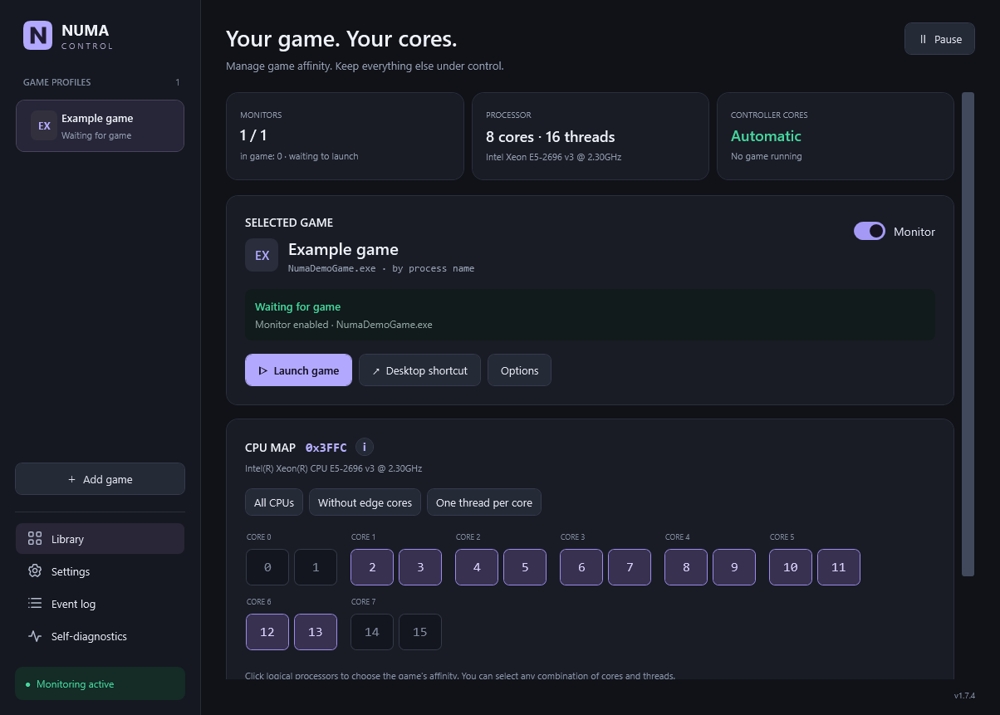
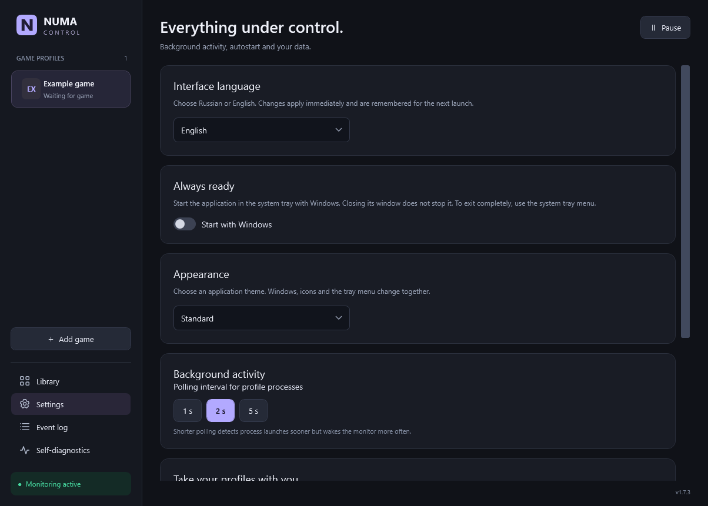
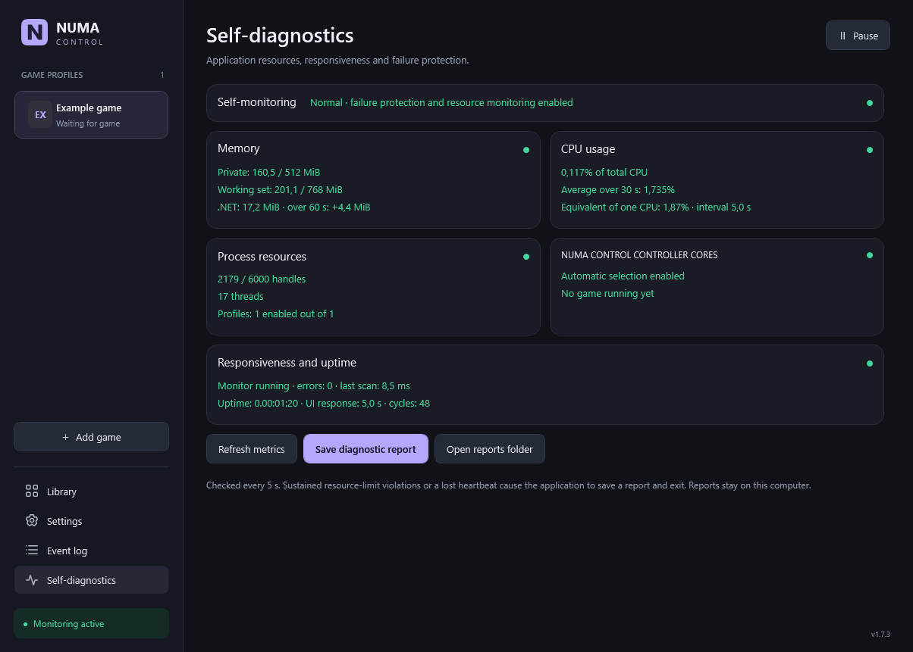
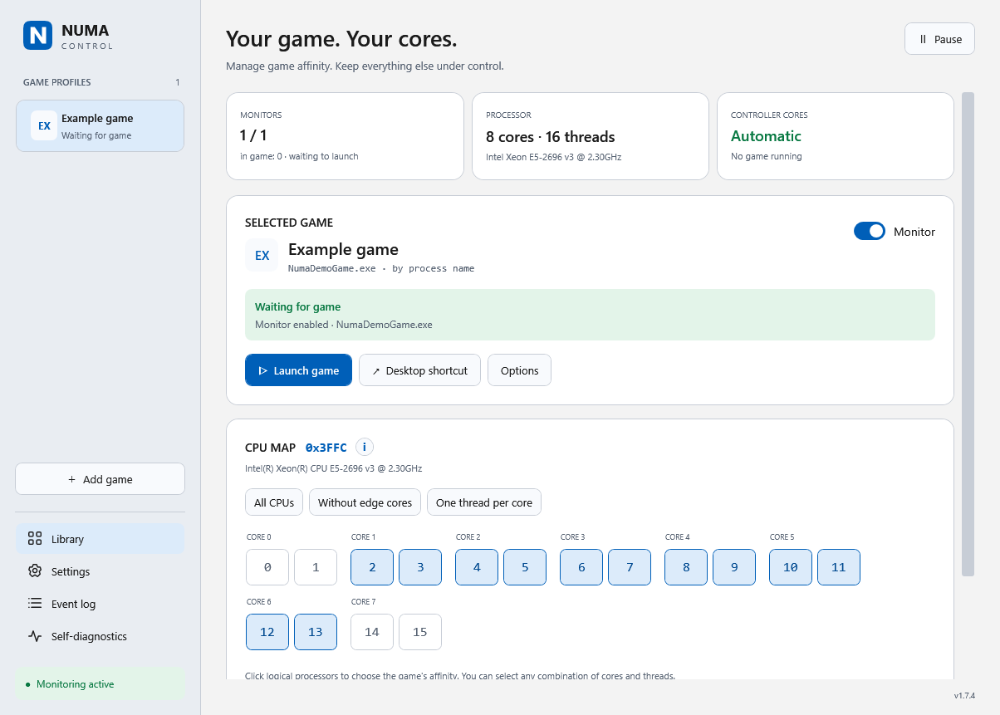
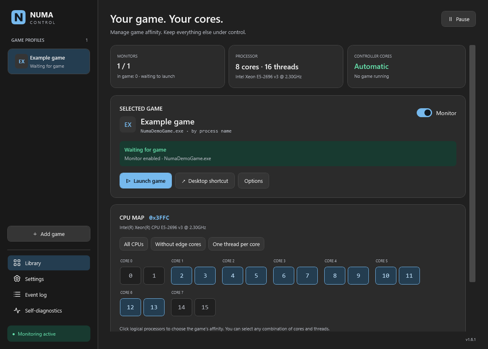
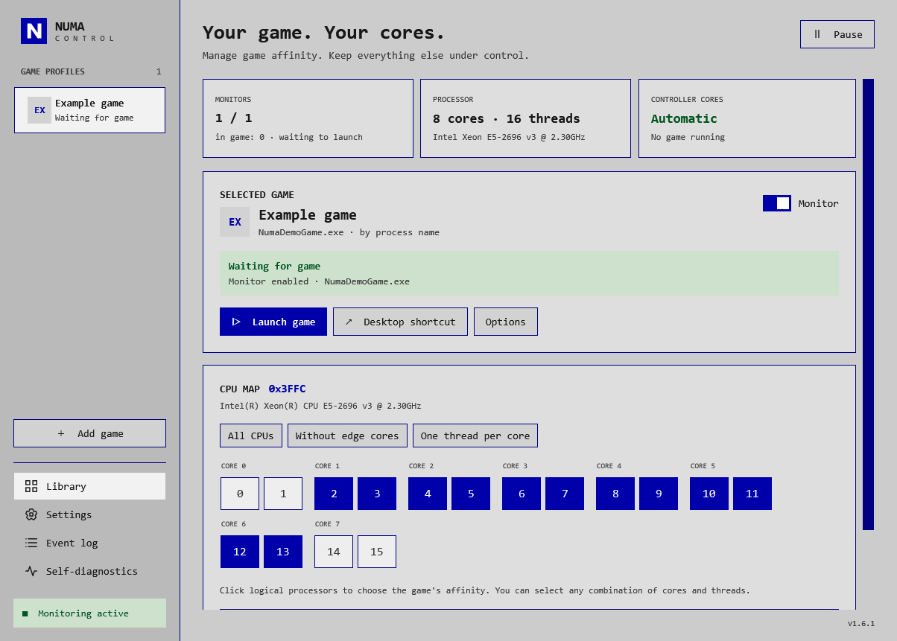

# NUMA Control

**[English](README.md) · [Русский](README.ru.md)**

A Windows desktop application for assigning game processes to selected CPU cores. Create game profiles, choose physical cores and SMT threads, and let a lightweight tray controller reapply your settings when a game starts.

[Download the latest release](https://github.com/mrPortnov/NUMA-Control/releases/latest) · [User guide](NumaControl/USER-GUIDE.md) · [Release history](CHANGELOG.md) · [Report an issue](https://github.com/mrPortnov/NUMA-Control/issues)



> **Anti-cheat warning:** Tested only with Valve Anti-Cheat (VAC). Compatibility with other anti-cheat systems has not been tested or confirmed. VAC testing is not certification or a guarantee against restrictions by the game. Check the rules of your game before using process affinity or priority tools.

NUMA Control uses documented Windows APIs to query processes and change their CPU affinity ([SetProcessAffinityMask](https://learn.microsoft.com/en-us/windows/win32/api/winbase/nf-winbase-setprocessaffinitymask)) and, optionally, priority ([SetPriorityClass](https://learn.microsoft.com/en-us/windows/win32/api/processthreadsapi/nf-processthreadsapi-setpriorityclass)). It does not inject DLLs or code, read or modify game memory, patch game files or bypass anti-cheat. It opens process handles for these Windows operations; this does not imply approval by an anti-cheat provider.

## What it does

NUMA Control sets a process CPU affinity mask through the normal Windows APIs. A profile describes the game executable, the allowed logical processors and optional launch settings. The controller watches for matching processes and reapplies the rule when necessary.

Affinity can help you experiment with a particular game and CPU configuration. It does **not** guarantee higher FPS or lower latency. Compare frame times and stability in your own workload before keeping a setting.

| Feature | Details |
|---|---|
| Interface language | Switch Russian / English in Settings; applied immediately, remembered after restart, including tray menus and dialogs |
| Game library | Profiles by executable name and optional exact path; matching is independent of temporary process IDs |
| Physical CPU map | Windows topology groups logical processors by physical core, including SMT siblings |
| Manual affinity | Select individual logical processors or use a preset; the resulting hexadecimal mask is visible |
| Background monitoring | Configurable 1, 2 or 5 second polling, per-game monitoring and a global pause |
| Launch and shortcuts | Start a game or supported launcher URI, create a game shortcut and keep the controller in the tray |
| Controller affinity | The application selects its own allowed cores separately from the game's mask |
| Optional priority | A profile can request High priority; RealTime is not used |
| Diagnostics | Memory, CPU, handles, responsiveness and local diagnostic reports |
| Recovery | Backups, profile validation, import/export and pause after recovery |
| Appearance | Standard, Windows 11 Light, Windows 11 Dark and AMI BIOS themes |

## Requirements

- Windows 10 or Windows 11, **x64**.
- **.NET Framework 4.8**. The modern .NET SDK is not required to run the app.
- A supported topology with **one processor group and 1–64 logical processors**. Applying rules is disabled for unsupported multi-group systems.
- A writable application/data location. Administrator rights are usually unnecessary; see the permissions section below.

This is a native Windows C# / WPF application. Linux, macOS and ARM64 builds are not provided. Game profiles are created by the user; a preconfigured personal library is not shipped.

## Install

Get files from [GitHub Releases](https://github.com/mrPortnov/NUMA-Control/releases). Use one distribution at a time.

| Package | Best for | How to start |
|---|---|---|
| `NUMA-Control-1.7.0-setup-x64.exe` | Recommended setup; downloads the official Microsoft .NET Framework 4.8 prerequisite only when missing | Run setup, then complete the application wizard |
| `NUMA-Control-1.7.0-setup-x64.msi` | A regular per-user installation and Windows uninstall/repair support | Run the installer, then launch NUMA Control from Start |
| `NUMA-Control-1.7.0-portable-x64.zip` | Running from an extracted folder without installation registration | Extract the entire ZIP to a writable folder and run `Open-NUMA.cmd` or `NUMA-Control.exe` |
| `SHA256SUMS.txt` | Verifying the downloaded distributions | Compare its hash with `Get-FileHash` |

### Recommended setup and .NET prerequisite

Run `NUMA-Control-1.7.0-setup-x64.exe`. It detects .NET Framework 4.8 or later and skips the download when it is present. Otherwise it downloads the official Microsoft web installer and installs the runtime before the application MSI. Internet access, administrator approval and sometimes a restart are required for the system runtime. Uninstalling NUMA Control does not remove shared .NET.

The separate MSI and portable ZIP require .NET Framework 4.8 to be installed already. They do not download dependencies. The application itself remains offline; network access belongs to the optional prerequisite setup.

### MSI installation

1. Close NUMA Control through its tray menu.
2. Run the MSI and choose a destination. The default is `%LOCALAPPDATA%\Programs\NUMA Control`.
3. Choose whether to add an application shortcut to the desktop. Game shortcuts are created separately inside the app.
4. Complete the wizard and open the app from Start.

The installer is per-user. Repair, upgrade and uninstall use Windows Installer. Uninstall removes the program and its registered shortcuts while preserving user-generated `data`; remove that folder separately only if you want to erase your profiles.

### Portable installation

1. Extract the complete ZIP to a stable writable directory.
2. Keep `NUMA-Control.exe.config` beside the EXE.
3. Run `Open-NUMA.cmd` or the EXE. Do not run directly inside the ZIP.
4. To move your installation, close the tray app and move the whole folder, including `data`. Recreate autostart and game shortcuts afterward.

Keep the application, configuration, launcher and documentation from the ZIP together.

### Verify a download

```powershell
Get-FileHash .\NUMA-Control-1.7.0-setup-x64.exe -Algorithm SHA256
Get-FileHash .\NUMA-Control-1.7.0-setup-x64.msi -Algorithm SHA256
Get-FileHash .\NUMA-Control-1.7.0-portable-x64.zip -Algorithm SHA256
```

Compare the output with the corresponding line in `SHA256SUMS.txt`. The ZIP also contains `SHA256.txt` for its individual files. Checksums verify integrity; the current application EXE, setup EXE and MSI are **not signed with a trusted code-signing certificate**.

## First game profile

1. Choose **Add game**, then select a process or executable.
2. Give the profile a recognizable name. For common executable names, set the exact game path as well.
3. Select the logical processors the game may use. Review the physical-core grouping before applying a preset.
4. Save the affinity and enable **Monitor**.
5. Start the game normally or choose **Launch game**. The profile shows waiting, applied, paused or access-error status.

Example process names are `cs2.exe` for Counter-Strike 2, `dota2.exe` for Dota 2 and `Game.exe` for Warface. Steam targets such as `steam://rungameid/730` and `steam://rungameid/570` are supported. The game process path and the launcher target are separate fields. Arbitrary shell commands are not executed as launch targets.

For **Epic Games, Battle.net and Ubisoft Connect**, choose the game EXE, then use **Use game shortcut** to import a game shortcut created by its launcher. If the client opens the game page, press **Play** there. For **Fortnite**, choose **Set up Fortnite** to fill the installed game EXE and Epic launch link. Windows may grant read access while denying changes to CPU affinity and priority. The profile status identifies the operation that failed.

The application does not bundle the games, inject into them or modify their files. It uses Windows process queries and affinity/priority operations; it does not read or modify game memory.

## Choosing cores

The numbers on the CPU map are Windows **logical processor numbers**, not a promise that every neighboring pair is a physical core. Grouping comes from the live Windows topology.

| Preset | Meaning |
|---|---|
| **All CPUs** | Allow every active logical processor |
| **Without edge cores** | Exclude the first and last physical core, including their SMT threads; keep all CPUs when there are two or fewer physical cores |
| **One thread per core** | Select the first Windows logical processor of each physical core; SMT is not disabled system-wide |

You can adjust any preset manually. Empty masks and incompatible masks are rejected. Existing saved masks are not silently replaced by a new preset. On supported hybrid CPUs, efficiency classes come from Windows rather than assumed P/E labels.

Pausing, exiting, deleting a profile or turning monitoring off leaves the current game's already assigned mask in place until the process exits. To broaden it while the game is running, explicitly apply **All CPUs**. Windows, drivers and other processes are not pinned to the excluded cores.

## Language, tray and diagnostics

Change the language at **Settings → Interface language → Русский / English**. On the default Russian interface, use **Настройки → Язык интерфейса**. Existing profiles keep Russian until you choose English. The choice is stored in the profile settings; profile names and existing log entries are not translated. Windows-provided file dialogs and system error messages can follow the Windows display language.

Closing the main window keeps the application running in the tray. Use **Exit** in its tray menu to stop it completely. Autostart is opt-in and starts the app in the tray for the current Windows user.



Self-diagnostics shows process resources and responsiveness. CPU use expressed as one logical CPU and as a share of the whole machine are different measurements. Reports are written locally when requested or after a detected failure. Review a report before sharing it: it may contain local paths and machine/process information.



*The memory trend appears after about a minute. A zero CPU reading while idle is normal.*

## Themes

Choose a theme at **Settings → Appearance**. The selection is saved and updates application windows, controls, navigation, tray/menu icons and the app's shortcuts. All themes provide the same features and preserve your profiles, language and affinity settings. Windows file dialogs keep the system appearance; the EXE file icon in Explorer stays the embedded standard icon.

| Theme | Appearance |
|---|---|
| **Standard** | Dark navy surfaces and violet accents; the default theme used throughout this README |
| **Windows 11 Light** | Light surfaces and blue accents |
| **Windows 11 Dark** | Dark neutral surfaces and light blue accents |
| **AMI BIOS** | Grey surfaces, saturated blue outlines, square controls and Consolas typography |

| Standard | Windows 11 Light |
|---|---|
|  |  |

| Windows 11 Dark | AMI BIOS |
|---|---|
|  |  |

## Data, backup and privacy

The normal data directory is **`data` beside the EXE**. If that location is not writable, the fallback is `%LOCALAPPDATA%\NumaControl`. Settings displays the location actually in use.

| File or folder | Purpose |
|---|---|
| `profiles.json` / `profiles.json.bak` | Profiles, settings and the previous valid save |
| `processor.json` | Local CPU topology snapshot, refreshed from Windows |
| `watcher.log` | Rotating local event log |
| `icons/` | Cached game icons and application graphics |
| `bug-reports/` | Manual and crash diagnostic reports |
| `legacy-backup/` | Backed-up known shortcuts during migration, if applicable |

Back up the whole data folder while the app is closed, or export profiles from Settings. Imports are validated and require confirmation; monitoring pauses so you can review the resulting rules. Exports include local executable paths and launch arguments, so do not upload a real export publicly without sanitizing it.

Profiles, logs and reports stay on your computer and are not sent automatically. Review reports and exports before sharing: they may contain local paths and process information.

## Permissions and troubleshooting

| Situation | What to check |
|---|---|
| The game is never detected | Use its actual EXE name; confirm the exact path if one is set; enable monitoring and clear global pause |
| Access denied | A protected or elevated game may require the controller to run at the same elevation; exit the ordinary instance first |
| Anti-cheat still denies access | Respect the restriction; the application does not bypass it and does not claim anti-cheat certification |
| Unexpected CPU usage | Check the event log, polling rate and diagnostics |
| CPU was replaced | Review paused profiles and masks against the new topology before resuming |
| Data is in an unexpected folder | Check the effective data path in Settings and whether the EXE directory is writable |
| A moved shortcut stops working | Recreate the shortcut and autostart entry from the new application folder |

Do not disable Windows security features to run the application. Unsigned packages may be restricted by Smart App Control or organizational policies.

## Documentation

[Detailed user guide](NumaControl/USER-GUIDE.md) · [Quick reference](NumaControl/README.md) · [Changelog](CHANGELOG.md)
