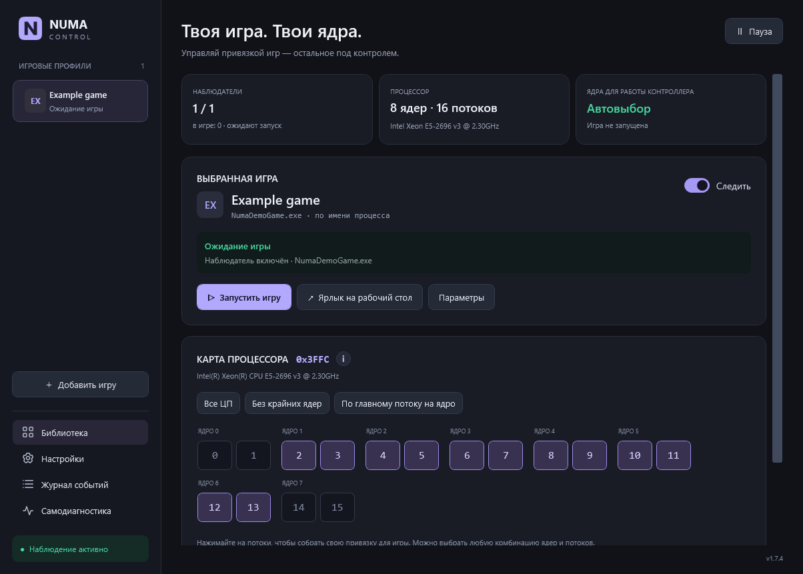
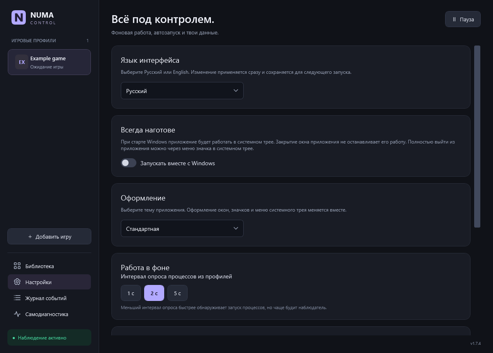
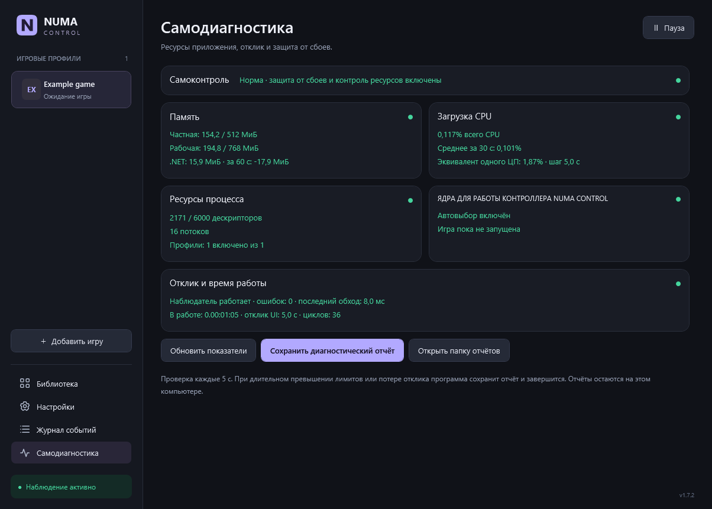
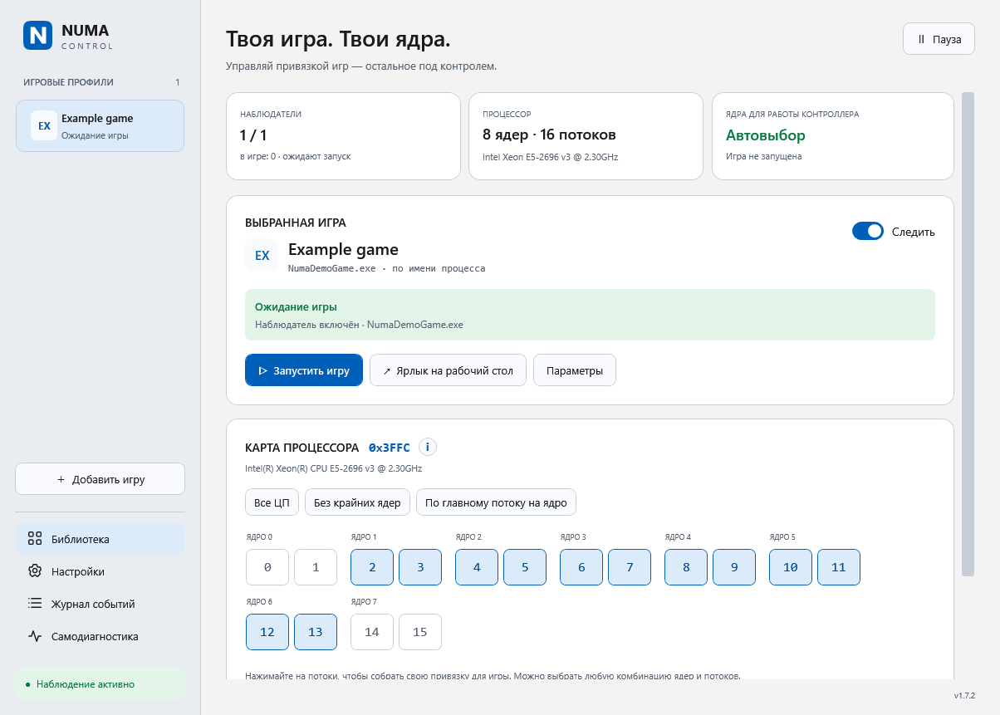
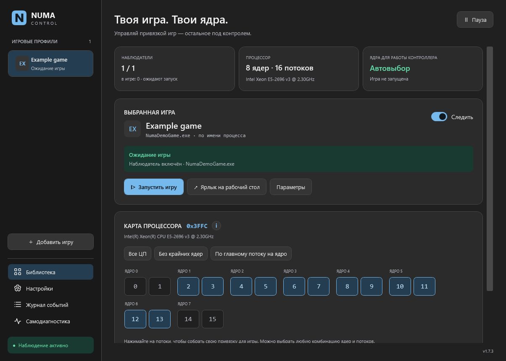
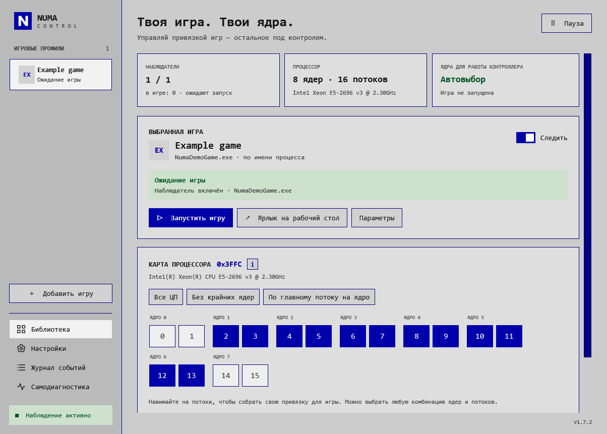

# NUMA Control

**[English](README.md) · [Русский](README.ru.md)**

Приложение Windows для привязки игровых процессов к выбранным ядрам CPU. Создавайте профили игр, выбирайте физические ядра и SMT-потоки; контроллер в трее будет применять правило при запуске игры и восстанавливать его при необходимости.

[Скачать актуальную версию](https://github.com/mrPortnov/NUMA-Control/releases/latest) · [Руководство пользователя](NumaControl/USER-GUIDE.ru.md) · [История изменений](CHANGELOG.ru.md) · [Сообщить о проблеме](https://github.com/mrPortnov/NUMA-Control/issues)



> **Предупреждение об античитах:** Проверено только с Valve Anti-Cheat (VAC). Совместимость с другими античитами не проверялась и не подтверждена. Проверка с VAC не является сертификацией или гарантией отсутствия ограничений со стороны игры. Перед использованием средств изменения привязки или приоритета процессов ознакомьтесь с правилами игры.

NUMA Control использует штатные Windows API для получения сведений о процессах и изменения CPU affinity ([SetProcessAffinityMask](https://learn.microsoft.com/en-us/windows/win32/api/winbase/nf-winbase-setprocessaffinitymask)), а при включённой опции — приоритета ([SetPriorityClass](https://learn.microsoft.com/en-us/windows/win32/api/processthreadsapi/nf-processthreadsapi-setpriorityclass)). Программа не внедряет DLL или код, не читает и не изменяет игровую память, не исправляет файлы игры и не обходит античит. Для этих операций Windows она открывает дескрипторы процессов; это не означает одобрения со стороны разработчика античита.

## Что делает программа

NUMA Control задаёт маску CPU affinity через штатные API Windows. Профиль описывает исполняемый файл игры, разрешённые логические процессоры и необязательные параметры запуска. Наблюдатель находит подходящий процесс и применяет правило.

Привязка позволяет экспериментировать с конкретной игрой и процессором. **Гарантии роста FPS или снижения задержки нет**: сравнивайте время кадра и стабильность на своей системе, прежде чем оставлять настройку постоянно.

| Возможность | Подробности |
|---|---|
| Язык интерфейса | Русский / English во вкладке «Настройки»; немедленное применение, сохранение после перезапуска, перевод трея и диалогов |
| Библиотека игр | Профили по имени EXE и необязательному точному пути; временный PID не используется как постоянный идентификатор |
| Физическая карта CPU | Логические процессоры группируются по реальной топологии Windows, с учётом SMT |
| Ручная привязка | Выбор отдельных потоков и пресеты; итоговая шестнадцатеричная маска видна в интерфейсе |
| Фоновое наблюдение | Интервалы 1, 2 и 5 секунд, наблюдение для отдельных игр и общая пауза |
| Запуск и ярлыки | Запуск игры или поддерживаемой ссылки лаунчера, игровые ярлыки, работа из трея |
| Ядра контроллера | Собственная привязка приложения выбирается отдельно от игровой маски |
| Приоритет | Профиль может запрашивать высокий приоритет; RealTime не используется |
| Диагностика | Память, CPU, дескрипторы, отклик и локальные отчёты |
| Восстановление | Резервные копии, проверка импорта/экспорта и пауза после восстановления |
| Оформление | Стандартная тема, Windows 11 Light, Windows 11 Dark и AMI BIOS |

## Системные требования

- Windows 10 или Windows 11, **x64**.
- **.NET Framework 4.8**. Для запуска не нужен современный .NET SDK.
- Поддерживаемая топология: **одна группа из 1–64 логических процессоров**. Для нескольких групп применение правил отключается с объяснением.
- Доступная для записи папка приложения/данных. Права администратора обычно не нужны; особенности доступа описаны ниже.

Программа написана на C# / WPF для Windows. Сборок для Linux, macOS и ARM64 нет. Игры добавляются пользователем; готовая личная библиотека в комплект не входит.

## Установка

Скачивайте файлы из [GitHub Releases](https://github.com/mrPortnov/NUMA-Control/releases). Используйте один вариант распространения за раз.

| Файл | Назначение | Запуск |
|---|---|---|
| `NUMA-Control-1.7.0-setup-x64.exe` | Рекомендуемый установщик; докачивает официальный .NET Framework 4.8, только если его нет | Откройте setup.exe и пройдите мастер установки |
| `NUMA-Control-1.7.0-setup-x64.msi` | Обычная установка для текущего пользователя, восстановление и удаление средствами Windows | Установите и запустите NUMA Control из меню «Пуск» |
| `NUMA-Control-1.7.0-portable-x64.zip` | Переносимая работа без регистрации установки | Полностью распакуйте в доступную для записи папку и откройте `Open-NUMA.cmd` или EXE |
| `SHA256SUMS.txt` | Проверка целостности скачанных дистрибутивов | Сравните хеш с `Get-FileHash` |

### Рекомендуемый setup.exe и компонент .NET

Откройте `NUMA-Control-1.7.0-setup-x64.exe`. Он определяет .NET Framework 4.8 или новее и пропускает загрузку, если компонент уже есть. При отсутствии скачивается официальный веб-установщик Microsoft, затем устанавливается .NET и основной MSI. Для системного компонента потребуются Интернет, подтверждение администратора и иногда перезагрузка. Удаление NUMA Control не удаляет общий .NET.

Отдельные MSI и portable ZIP предполагают уже установленный .NET Framework 4.8 и сами зависимости не скачивают. Приложение остаётся автономным; сетевые запросы выполняет установщик недостающего компонента.

### MSI-установщик

1. Закройте работающую программу через меню трея.
2. Откройте MSI и выберите папку. Стандартный путь — `%LOCALAPPDATA%\Programs\NUMA Control`.
3. Выберите, нужен ли ярлык приложения на рабочем столе. Игровые ярлыки создаются отдельно внутри программы.
4. Завершите мастер и запустите NUMA Control из «Пуска».

Установка выполняется для текущего пользователя. Обновление, восстановление и удаление обслуживает Windows Installer. Удаление убирает программу и её зарегистрированные ярлыки, сохраняя пользовательскую папку `data`. Чтобы стереть профили полностью, удалите её отдельно после закрытия приложения.

### Portable-версия

1. Распакуйте весь ZIP в постоянную папку с доступом на запись.
2. Сохраните `NUMA-Control.exe.config` рядом с EXE.
3. Откройте `Open-NUMA.cmd` или `NUMA-Control.exe`. Не запускайте программу из окна архива.
4. Для переноса закройте программу через трей и переместите всю папку вместе с `data`. Затем пересоздайте автозапуск и игровые ярлыки.

Храните приложение, конфигурацию, команду запуска и документацию из ZIP вместе.

### Проверка скачанных файлов

```powershell
Get-FileHash .\NUMA-Control-1.7.0-setup-x64.exe -Algorithm SHA256
Get-FileHash .\NUMA-Control-1.7.0-setup-x64.msi -Algorithm SHA256
Get-FileHash .\NUMA-Control-1.7.0-portable-x64.zip -Algorithm SHA256
```

Сверьте результат со строкой нужного файла в `SHA256SUMS.txt`. Внутри ZIP есть `SHA256.txt` для отдельных файлов. Хеш подтверждает целостность, но не заменяет подпись: текущие EXE приложения, setup.exe и MSI **не подписаны доверенным сертификатом**.

## Первая игра

1. Нажмите **Добавить игру**, выберите процесс или исполняемый файл.
2. Укажите понятное имя профиля. Для распространённого имени EXE лучше задать точный путь самой игры.
3. Выберите разрешённые логические процессоры. Перед применением пресета проверьте физические группы ядер.
4. Сохраните привязку и включите **Следить**.
5. Запустите игру обычным способом или кнопкой **Запустить игру**. Профиль покажет ожидание, применённое правило, паузу либо ошибку доступа.

Примеры имён процессов: `cs2.exe` для Counter-Strike 2, `dota2.exe` для Dota 2 и `Game.exe` для Warface. Поддерживаются цели Steam вроде `steam://rungameid/730` и `steam://rungameid/570`. Точный путь процесса игры и цель запуска лаунчера — разные поля. Произвольные команды оболочки как цель запуска не исполняются.

Для **Epic Games, Battle.net и Ubisoft Connect** выберите EXE игры, затем нажмите **Взять цель из ярлыка** и укажите ярлык игры, созданный лаунчером. Если клиент открыл страницу игры, нажмите в нём **Играть**. Для **Fortnite** кнопка **Настроить Fortnite** заполнит путь к установленному игровому EXE и ссылку Epic. Windows может разрешить чтение параметров процесса и запретить изменение привязки и приоритета. В статусе профиля указано, какая операция завершилась ошибкой.

Программа не включает сами игры, не внедряется в них и не меняет их файлы. Используются запросы сведений о процессе и штатное назначение привязки/приоритета Windows; память игры не читается и не изменяется.

## Как выбирать ядра

Числа на карте — **номера логических процессоров Windows**. Нельзя заранее считать каждую соседнюю пару физическим ядром: группировка определяется по живой топологии Windows.

| Пресет | Значение |
|---|---|
| **Все ЦП** | Разрешить все активные логические процессоры |
| **Без крайних ядер** | Исключить первое и последнее физическое ядро со всеми SMT-потоками; при двух и менее физических ядрах оставить все ЦП |
| **По главному потоку на ядро** | Выбрать первый логический процессор Windows каждого физического ядра; SMT для системы не отключается |

После пресета можно вручную изменить любые потоки. Пустые и несовместимые маски запрещены. Сохранённая пользовательская маска не подменяется новым пресетом автоматически. Для поддерживаемых гибридных CPU классы эффективности берутся из Windows, без предположений о названиях P/E.

Пауза, выход, удаление профиля и выключение наблюдения оставляют уже назначенную маску текущего игрового процесса до его завершения. Чтобы расширить её во время игры, явно примените **Все ЦП**. Windows, драйверы и другие процессы на исключённых ядрах не закрепляются.

## Язык, трей и диагностика

Выбор языка находится в **Настройки → Язык интерфейса → Русский / English**. Изменение применяется сразу и сохраняется после перезапуска. Для существующих профилей начальным остаётся русский. Названия пользовательских профилей и ранее записанные строки журнала не переводятся. Системные окна выбора файлов и сообщения Windows могут следовать языку самой Windows.

Закрытие основного окна оставляет программу в трее. Для полного завершения выберите **Выход** в меню значка. Автозапуск включается пользователем и запускает программу в трее текущего пользователя Windows.



Самодиагностика показывает ресурсы процесса и отклик. Процент CPU относительно одного логического процессора отличается от доли всего компьютера. Ручные и аварийные отчёты сохраняются локально. Перед передачей отчёта проверьте его: он может содержать пути и сведения о компьютере и процессах.



*Тренд памяти появляется примерно через минуту. Нулевой CPU в простое — нормальное показание.*

## Темы оформления

Тема выбирается в **Настройки → Оформление**. Выбор сохраняется и меняет окна, элементы управления, навигацию, значки приложения и трея, меню трея и ярлыки этой копии программы. Возможности всех тем одинаковы; профили, язык и маски не меняются. Системные файловые диалоги сохраняют оформление Windows, а значок файла EXE в Проводнике остаётся встроенным стандартным.

| Тема | Оформление |
|---|---|
| **Стандартная** | Тёмно-синие поверхности и фиолетовые акценты; основная тема на остальных скриншотах README |
| **Windows 11 Light** | Светлые поверхности и синие акценты |
| **Windows 11 Dark** | Тёмные нейтральные поверхности и светло-синие акценты |
| **AMI BIOS** | Серые поверхности, насыщенные синие рамки, прямоугольные элементы и шрифт Consolas |

| Стандартная | Windows 11 Light |
|---|---|
|  |  |

| Windows 11 Dark | AMI BIOS |
|---|---|
|  |  |

## Данные, копии и конфиденциальность

Обычная папка данных — **`data` рядом с EXE**. Если запись туда недоступна, используется `%LOCALAPPDATA%\NumaControl`. Фактический путь виден в настройках.

| Файл или папка | Назначение |
|---|---|
| `profiles.json` / `profiles.json.bak` | Библиотека, настройки и предыдущее корректное сохранение |
| `processor.json` | Снимок топологии CPU, обновляемый из Windows |
| `watcher.log` | Локальный журнал с ротацией |
| `icons/` | Кэш игровых значков и оформления |
| `bug-reports/` | Ручные и аварийные отчёты |
| `legacy-backup/` | Резервные копии известных ярлыков при переходе, если они обнаружены |

Для резервной копии закройте программу и сохраните всю папку данных либо экспортируйте профили в настройках. Импорт проходит проверку и требует подтверждения; наблюдение ставится на паузу для проверки правил. Экспорт содержит локальные пути и аргументы запуска — реальный файл экспорта нельзя выкладывать публично без обезличивания.

Профили, журналы и отчёты хранятся на вашем компьютере и не отправляются автоматически. Перед передачей изучите отчёт или экспорт: в них могут быть локальные пути и сведения о процессах.

## Доступ и типичные проблемы

| Ситуация | Что проверить |
|---|---|
| Игра не обнаруживается | Имя настоящего EXE, точный путь, включённое наблюдение и общую паузу |
| Ошибка доступа | Игра с повышенными правами может требовать таких же прав контроллера; сначала выйдите из обычного экземпляра |
| Античит запрещает операцию | Учитывайте ограничение: программа не обходит защиту и не заявляет сертификацию античитами |
| Необычная нагрузка CPU | Журнал, интервал опроса и показатели самодиагностики |
| Заменён процессор | Проверьте приостановленные профили и маски для новой топологии |
| Данные лежат не рядом с EXE | Фактический путь в настройках и права записи в папку программы |
| Ярлык перестал работать после переноса | Пересоздайте ярлык и автозапуск из новой папки |

Не отключайте механизмы безопасности Windows ради запуска. Неподписанные пакеты могут ограничиваться Smart App Control или корпоративной политикой.

## Документация

[Подробное руководство](NumaControl/USER-GUIDE.ru.md) · [Краткая справка](NumaControl/README.ru.md) · [История изменений](CHANGELOG.ru.md)
