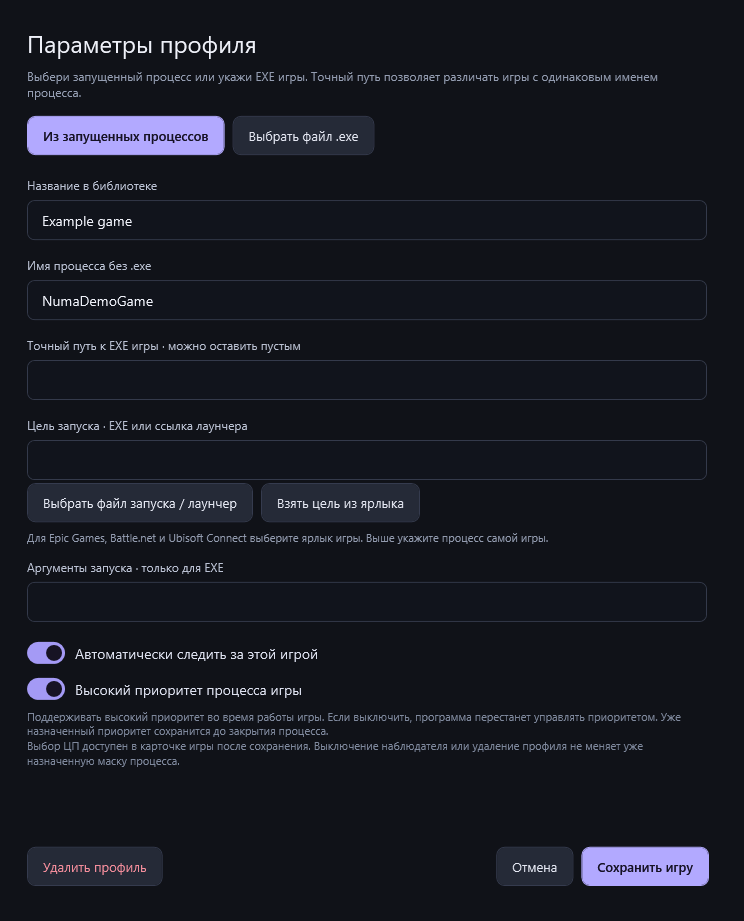
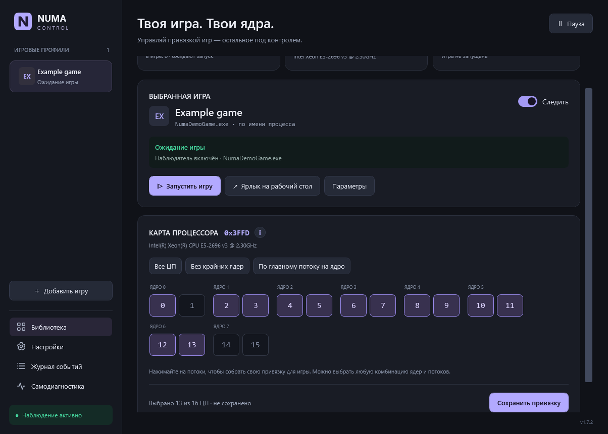

# NUMA Control

**[English](README.md) · [Русский](README.ru.md)**

Приложение Windows для привязки игровых процессов к выбранным ядрам CPU. Создавайте профили игр, выбирайте физические ядра и SMT-потоки; контроллер в трее будет применять правило при запуске игры и восстанавливать его при необходимости.

[Скачать актуальную версию](https://github.com/mrPortnov/NUMA-Control/releases/latest) · [Руководство пользователя](NumaControl/USER-GUIDE.ru.md) · [История изменений](CHANGELOG.ru.md) · [Сообщить о проблеме](https://github.com/mrPortnov/NUMA-Control/issues)

Возможности и скриншоты на этой странице относятся к **1.7.3**. Руководство для скачанной версии находится в папке установленной программы или в архиве portable.


> **Совместимость с античитами.** Жёсткая привязка и приоритет проверены только с Valve Anti-Cheat (VAC). В отдельной проверке Fortnite при активном Easy Anti-Cheat игра запустилась через Epic и Windows применила CPU Sets. В повышении приоритета Windows отказала. Перед настройкой планирования процессов проверьте правила своей игры.

NUMA Control использует штатные Windows API для получения сведений о процессах, выбора ЦП и запроса приоритета. Для Fortnite применяется Windows CPU Sets. Программа открывает дескрипторы процессов для этих операций, не внедряет код, не читает и не изменяет память игры, не правит её файлы и не обходит античит. [Привязка ЦП в Windows](https://learn.microsoft.com/en-us/windows/win32/api/winbase/nf-winbase-setprocessaffinitymask) · [Windows CPU Sets](https://learn.microsoft.com/en-us/windows/win32/procthread/cpu-sets) · [Приоритет процесса](https://learn.microsoft.com/en-us/windows/win32/api/processthreadsapi/nf-processthreadsapi-setpriorityclass)

## Что делает программа

Профиль хранит исполняемый файл игры, выбранные логические процессоры и необязательные параметры запуска. Наблюдатель находит подходящий процесс и применяет выбранные ЦП через Windows API.

Привязка позволяет экспериментировать с конкретной игрой и процессором. **Гарантии роста FPS или снижения задержки нет**: сравнивайте время кадра и стабильность на своей системе, прежде чем оставлять настройку постоянно.

| Возможность | Подробности |
|---|---|
| Язык интерфейса | Русский / English во вкладке «Настройки»; немедленное применение, сохранение после перезапуска, перевод трея и диалогов |
| Библиотека игр | Профили по имени EXE и необязательному точному пути; временный PID не используется как постоянный идентификатор |
| Физическая карта CPU | Логические процессоры группируются по реальной топологии Windows, с учётом SMT |
| Ручная привязка | Выбор отдельных потоков и пресеты; итоговая шестнадцатеричная маска видна в интерфейсе |
| Фоновое наблюдение | Интервалы 1, 2 и 5 секунд, наблюдение для отдельных игр и общая пауза |
| Запуск и ярлыки | Запуск игры или поддерживаемой ссылки лаунчера, игровые ярлыки, работа из трея |
| Ядра контроллера | Собственная привязка приложения выбирается отдельно от игровой маски |
| Приоритет | Профиль может запрашивать высокий приоритет; RealTime не используется |
| Диагностика | Память, CPU, дескрипторы, отклик и локальные отчёты |
| Восстановление | Резервные копии, проверка импорта/экспорта и пауза после восстановления |
| Оформление | Стандартная тема, Windows 11 Light, Windows 11 Dark и AMI BIOS |

## Системные требования

- Windows 10 или Windows 11, **x64**.
- **.NET Framework 4.8**. Для запуска не нужен современный .NET SDK.
- Поддерживаемая топология: **одна группа из 1–64 логических процессоров**. Для нескольких групп применение правил отключается с объяснением.
- Доступная для записи папка приложения/данных. Права администратора обычно не нужны; особенности доступа описаны ниже.

Программа написана на C# / WPF для Windows. Сборок для Linux, macOS и ARM64 нет. Игры добавляются пользователем; готовая личная библиотека в комплект не входит.

## Установка

Скачивайте файлы из [GitHub Releases](https://github.com/mrPortnov/NUMA-Control/releases). В имени файла вместо `VERSION` указан номер релиза. Используйте один вариант распространения за раз.

| Файл | Назначение | Запуск |
|---|---|---|
| `NUMA-Control-VERSION-setup-x64.exe` | Рекомендуемый установщик; докачивает официальный .NET Framework 4.8, только если его нет | Откройте setup.exe и пройдите мастер установки |
| `NUMA-Control-VERSION-setup-x64.msi` | Обычная установка для текущего пользователя, восстановление и удаление средствами Windows | Установите и запустите NUMA Control из меню «Пуск» |
| `NUMA-Control-VERSION-portable-x64.zip` | Переносимая работа без регистрации установки | Полностью распакуйте в доступную для записи папку и откройте `Open-NUMA.cmd` или EXE |
| `SHA256SUMS.txt` | Проверка целостности скачанных дистрибутивов | Сравните хеш с `Get-FileHash` |

### Рекомендуемый setup.exe и компонент .NET

Откройте `NUMA-Control-VERSION-setup-x64.exe`. Он определяет .NET Framework 4.8 или новее и пропускает загрузку, если компонент уже есть. При отсутствии скачивается официальный веб-установщик Microsoft, затем устанавливается .NET и основной MSI. Для системного компонента потребуются Интернет, подтверждение администратора и иногда перезагрузка. Удаление NUMA Control не удаляет общий .NET.

Чтобы обновить установку, сделанную через setup.exe, выйдите из NUMA Control через трей и запустите новый setup.exe. Обновление сохраняет профили и оставляет одну запись NUMA Control в списке установленных приложений Windows. Если вы устанавливали отдельный MSI, используйте для обновления новый MSI.

Отдельные MSI и portable ZIP предполагают уже установленный .NET Framework 4.8 и сами зависимости не скачивают. Приложение остаётся автономным; сетевые запросы выполняет установщик недостающего компонента.

### MSI-установщик

1. Закройте работающую программу через меню трея.
2. Откройте MSI и выберите папку. Стандартный путь — `%LOCALAPPDATA%\Programs\NUMA Control`.
3. Выберите, нужен ли ярлык приложения на рабочем столе. Игровые ярлыки создаются отдельно внутри программы.
4. Завершите мастер и запустите NUMA Control из «Пуска».

Установка выполняется для текущего пользователя. Обновление, восстановление и удаление обслуживает Windows Installer. Удаление убирает программу и её зарегистрированные ярлыки, сохраняя пользовательскую папку `data`. Чтобы стереть профили полностью, удалите её отдельно после закрытия приложения.

### Portable-версия

1. Распакуйте весь ZIP в постоянную папку с доступом на запись.
2. Сохраните `NUMA-Control.exe.config` рядом с EXE.
3. Откройте `Open-NUMA.cmd` или `NUMA-Control.exe`. Не запускайте программу из окна архива.
4. Для переноса закройте программу через трей и переместите всю папку вместе с `data`. Затем пересоздайте автозапуск и игровые ярлыки.

Храните приложение, конфигурацию, команду запуска и документацию из ZIP вместе.

### Проверка скачанных файлов

```powershell
Get-FileHash -Path .\NUMA-Control-* -Algorithm SHA256
```

Сверьте результат со строкой нужного файла в `SHA256SUMS.txt`. Внутри ZIP есть `SHA256.txt` для отдельных файлов. Хеш подтверждает целостность, но не заменяет подпись: текущие EXE приложения, setup.exe и MSI **не подписаны доверенным сертификатом**.

## Первая игра

1. Один раз запустите игру, нажмите **Добавить игру → Из запущенных процессов** и выберите саму игру. Если игра закрыта, воспользуйтесь кнопкой **Выбрать файл .exe**.
2. Укажите понятное имя профиля. Сохраните точный путь, если у нескольких игр совпадает имя EXE. Сохраните профиль, чтобы открыть его карту процессора.
3. Выберите пресет или отметьте ЦП на карте. Нажмите **Сохранить привязку** и включите **Следить**. Снимите общую паузу, если она включена.
4. Откройте игру из лаунчера или кнопкой **Запустить игру**. Проверьте карточку игры. **Ожидание игры** означает, что подходящий процесс пока не найден. Статус **Нужна проверка** показывает операцию и ошибку.



### Какой файл или ссылку указать

| Откуда запускается игра | Что указать в профиле |
|---|---|
| Напрямую из EXE | Выберите EXE игры. При необходимости укажите аргументы для этого файла. |
| Steam | Укажите EXE игры, а в поле цели запуска — её ссылку Steam. Например, `cs2.exe` и `steam://rungameid/730` либо `dota2.exe` и `steam://rungameid/570`. |
| Epic Games, Battle.net или Ubisoft Connect | Выберите EXE игры, нажмите **Взять цель из ярлыка** и откройте ярлык, созданный клиентом. Если он открыл страницу игры, нажмите **Играть** в клиенте. |

Для Fortnite выберите `FortniteClient-Win64-Shipping.exe` как процесс игры. Для запуска кнопкой **Запустить игру** импортируйте ярлык, созданный в Epic. В существующем профиле откройте **Параметры → Взять цель из ярлыка**. Игру также можно запустить прямо из Epic. [Как создать ярлык игры в Epic Games](https://www.epicgames.com/help/c-32735058/c-36403860/a20183292)

### CPU Sets и жёсткая привязка

Наведите указатель на **ⓘ** рядом с картой процессора в **Библиотеке**, чтобы узнать режим выбранного профиля. Жёсткая маска ограничивает, на каких ЦП процесс может выполняться. Для Fortnite NUMA Control использует **Windows CPU Sets**, чтобы задать ЦП по умолчанию для потоков без собственного назначения. Диспетчер задач при этом может показывать все ЦП в жёсткой маске игры. Если жёсткая маска ограничивает выбор CPU Sets, Windows отдаёт приоритет маске. [Документация Microsoft о CPU Sets](https://learn.microsoft.com/en-us/windows/win32/procthread/cpu-sets)

**Правило применено** подтверждает успешное применение. В карточке игры указано, если использовались CPU Sets. Если **Нужна проверка** подтверждает CPU Sets и сообщает об отказе в высоком приоритете, выбор ЦП применён, а запрос приоритета отклонён. Чтобы настраивать только ЦП, выключите **Высокий приоритет процесса игры** в параметрах профиля.

## Как выбирать ядра

Числа на карте — **номера логических процессоров Windows**. Нельзя заранее считать каждую соседнюю пару физическим ядром: группировка определяется по живой топологии Windows.

| Пресет | Значение |
|---|---|
| **Все ЦП** | Разрешить все активные логические процессоры |
| **Без крайних ядер** | Исключить первое и последнее физическое ядро со всеми SMT-потоками; при двух и менее физических ядрах оставить все ЦП |
| **По главному потоку на ядро** | Выбрать первый логический процессор Windows каждого физического ядра; SMT для системы не отключается |

После пресета можно вручную изменить любые потоки. Пустые и несовместимые маски запрещены. Сохранённая пользовательская маска не подменяется новым пресетом автоматически. Для поддерживаемых гибридных CPU классы эффективности берутся из Windows, без предположений о названиях P/E.



Например, если Windows показывает восемь двухпоточных ядер по порядку, пресет **Без крайних ядер** оставит логические ЦП 2–13. Перед выбором проверьте группы на своей карте процессора. Значение в шестнадцатеричном виде показывает, какие ЦП отмечены.

Пауза, выход, удаление профиля и выключение наблюдения сохраняют действующее назначение ЦП запущенной игры. Чтобы расширить выбор во время игры, примените **Все ЦП** при включённом наблюдении. Контроллер выбирает собственные ядра по жёстким маскам игр, в том числе когда профиль Fortnite использует CPU Sets.

## Язык, трей и диагностика

Выбор языка находится в **Настройки → Язык интерфейса → Русский / English**. Изменение применяется сразу и сохраняется после перезапуска. Для существующих профилей начальным остаётся русский. Названия пользовательских профилей и ранее записанные строки журнала не переводятся. Системные окна выбора файлов и сообщения Windows могут следовать языку самой Windows.

Закрытие основного окна оставляет программу в трее. Для полного завершения выберите **Выход** в меню значка. Автозапуск включается пользователем и запускает программу в трее текущего пользователя Windows.


Самодиагностика показывает ресурсы процесса и отклик. Процент CPU относительно одного логического процессора отличается от доли всего компьютера. Ручные и аварийные отчёты сохраняются локально. Перед передачей отчёта проверьте его: он может содержать пути и сведения о компьютере и процессах.


*Тренд памяти появляется примерно через минуту. Нулевой CPU в простое — нормальное показание.*

Откройте **Журнал событий → Обновить**, чтобы увидеть последние операции. Если Windows отказала в доступе, найдите игру по имени или PID и проверьте операцию рядом. Подтверждение CPU Sets и отказ в приоритете могут появиться одновременно. Для обращения за помощью достаточно нужных строк журнала.

## Темы оформления

Тема выбирается в **Настройки → Оформление**. Выбор сохраняется и меняет окна, элементы управления, навигацию, значки приложения и трея, меню трея и ярлыки этой копии программы. Возможности всех тем одинаковы; профили, язык и маски не меняются. Системные файловые диалоги сохраняют оформление Windows, а значок файла EXE в Проводнике остаётся встроенным стандартным.

| Тема | Оформление |
|---|---|
| **Стандартная** | Тёмно-синие поверхности и фиолетовые акценты; основная тема на остальных скриншотах README |
| **Windows 11 Light** | Светлые поверхности и синие акценты |
| **Windows 11 Dark** | Тёмные нейтральные поверхности и светло-синие акценты |
| **AMI BIOS** | Серые поверхности, насыщенные синие рамки, прямоугольные элементы и шрифт Consolas |

| Стандартная | Windows 11 Light |
|---|---|
|  |  |

| Windows 11 Dark | AMI BIOS |
|---|---|
|  |  |

## Данные, копии и конфиденциальность

Обычная папка данных — **`data` рядом с EXE**. Если запись туда недоступна, используется `%LOCALAPPDATA%\NumaControl`. Фактический путь виден в настройках.

| Файл или папка | Назначение |
|---|---|
| `profiles.json` / `profiles.json.bak` | Библиотека, настройки и предыдущее корректное сохранение |
| `processor.json` | Снимок топологии CPU, обновляемый из Windows |
| `watcher.log` | Локальный журнал с ротацией |
| `icons/` | Кэш игровых значков и оформления |
| `bug-reports/` | Ручные и аварийные отчёты |
| `legacy-backup/` | Резервные копии известных ярлыков при переходе, если они обнаружены |

Для переноса на другой компьютер воспользуйтесь **Настройки → Экспорт профилей**. На новом компьютере выберите **Импорт профилей**, проверьте пути к EXE и выбранные ЦП, затем возобновите наблюдение. Для полной резервной копии на том же ПК закройте NUMA Control через трей и скопируйте папку данных. Перед передачей экспорта проверьте локальные пути и аргументы запуска.

Профили, журналы и отчёты хранятся на вашем компьютере и не отправляются автоматически. Перед передачей изучите отчёт или экспорт: в них могут быть локальные пути и сведения о процессах.

Сообщения об уязвимостях можно отправить приватно через GitHub. [Сообщить об уязвимости](https://github.com/mrPortnov/NUMA-Control/security/advisories/new)

## Доступ и типичные проблемы

| Ситуация | Что проверить |
|---|---|
| Игра не обнаруживается | Имя настоящего EXE, точный путь, включённое наблюдение и общую паузу |
| Ошибка доступа | Игра с повышенными правами может требовать таких же прав контроллера; сначала выйдите из обычного экземпляра |
| Античит запрещает операцию | Учитывайте ограничение: программа не обходит защиту и не заявляет сертификацию античитами |
| Необычная нагрузка CPU | Журнал, интервал опроса и показатели самодиагностики |
| Заменён процессор | Проверьте приостановленные профили и маски для новой топологии |
| Данные лежат не рядом с EXE | Фактический путь в настройках и права записи в папку программы |
| Ярлык перестал работать после переноса | Пересоздайте ярлык и автозапуск из новой папки |

Не отключайте механизмы безопасности Windows ради запуска. Неподписанные пакеты могут ограничиваться Smart App Control или корпоративной политикой.

## Документация

[Подробное руководство](NumaControl/USER-GUIDE.ru.md) · [Краткая справка](NumaControl/README.ru.md) · [История изменений](CHANGELOG.ru.md)
